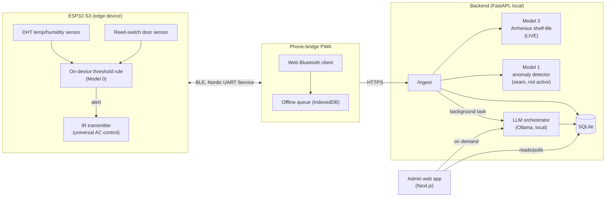
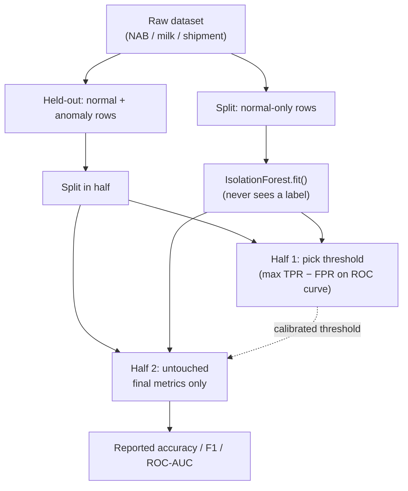
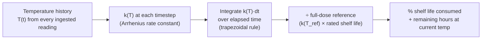
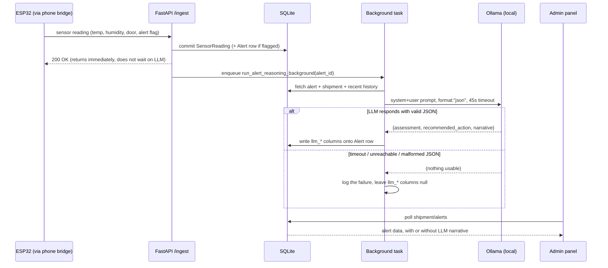
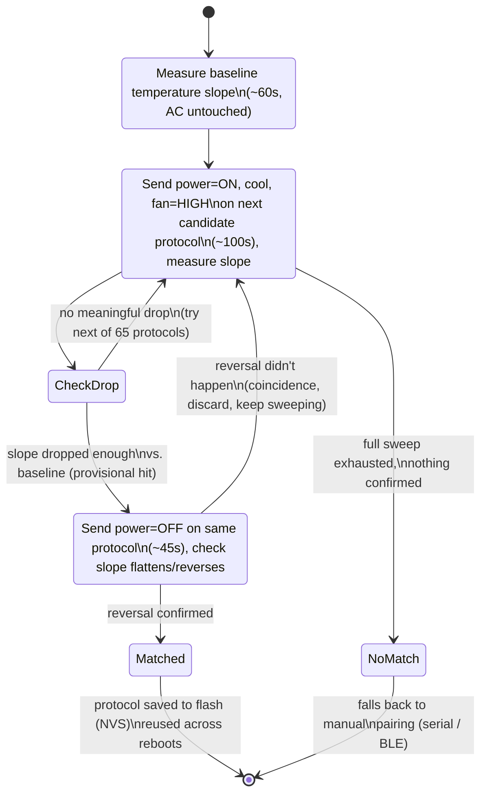

# FROSTMIND — AI Models & Training Briefing

**Purpose of this document:** everything you need to explain the AI/ML side of FROSTMIND to your professor and to build a 6–7 slide deck from it (hand this file to any agent/tool and say "turn this into slides" — it's already broken into slide-sized sections). Every number in here is pulled directly from the running code and its actual training-script output as of 2026-09-06, not from the original plan documents — where reality diverged from the plan, this doc says so explicitly.

**The one framing sentence to open with:** *"We built the sensing and control loop first, because the models need real operating data that only that loop can produce — so today you'll see one deterministic rule that's live in production, one physics-based model that's live in production, one trained classifier that's fully built and validated on external benchmarks but correctly not yet switched on, one model that's deliberately not built because its hardware isn't sourced, and a local LLM layer that turns all of the above into a plain-English explanation for a human."* That sentence is the whole story — everything below just backs it up.

---

## Slide 1 — What FROSTMIND Is

FROSTMIND is a cold-chain monitoring and intervention system: an ESP32-S3 sensor node watches temperature/humidity/door-state on a refrigerated shipment (a truck reefer unit in the target deployment; a room air conditioner as the physical stand-in for testing), decides when something's wrong, and can **act** — firing an IR command at the cooling unit — without any human in the loop, then explains itself to one afterward.



**Why this shape:** the ESP32 has no internet radio, so a phone acts as a Bluetooth-to-HTTPS bridge — this is also why "always-on background connectivity" has a hard ceiling (a browser tab can't run truly in the background; this is disclosed honestly in the phone-bridge docs rather than papered over).

Everything downstream of `/ingest` is where the AI actually lives. There are, precisely, **four AI/reasoning components** plus one deterministic on-device rule. The rest of this document is one slide per component.

---

## Slide 2 — The AI Design Philosophy: Stage the Models to the Data You Actually Have

The single biggest technical-judgment point to make to your professor: **we did not train a model before we had data to train it on, and we say so out loud instead of hiding it.** This is the actual staged plan, and where each stage really is today:

| Stage | What it is | Status | Unlocked by |
|---|---|---|---|
| **0 — Threshold rule** | Deterministic rate-of-change + setpoint-deviation check, on-device | ✅ **Live**, firing real IR commands | Nothing — this is the floor everything else builds on |
| **1 — Isolation Forest anomaly detector** | Offline-trained unsupervised model | ✅ **Built & validated** on 4 real/simulated benchmark datasets · ⏸️ **not switched on** against live telemetry (see Slide 3 for exactly why) | FROSTMIND's own logged hardware sessions (not collected yet) |
| **2 — Root-cause classifier** | Distinguish *why* an anomaly happened (compressor fault vs. door left open vs. power loss) | ❌ **Not built**, deliberately | An INA219 power-draw sensor — not sourced, not a software gap |
| **3 — Arrhenius shelf-life kinetics** | Physics-based degradation model, not machine-learned | ✅ **Live**, computing real numbers on every reading | Nothing — it's a formula, needs no training data |
| **4 — Local LLM reasoning layer** | Ollama-hosted LLM narrating alerts and writing compliance reports | ✅ **Live**, running in production ahead of the original plan's schedule | Ollama running locally — already in place |

The honest, sellable narrative: *"the instrumentation had to exist before the model could, because the model needs data only the instrumentation produces — that's not a missing feature, that's the correct order of operations."* Say this plainly rather than implying Stage 1 is "done" in the sense of running live — it's genuinely trained and evaluated, just not yet pointed at FROSTMIND's own sensor stream, and that distinction is worth being precise about if asked.

---

## Slide 3 — Model 1: Anomaly Detection (Isolation Forest)

**Algorithm:** `sklearn.ensemble.IsolationForest`, `contamination=0.02`, trained **only on rows/sessions labeled normal** — the model never sees an anomaly label during training. It learns what "normal" looks like in feature space and flags anything that's an outlier relative to that.

**Features** (`roll_mean`, `roll_std`, `rate_of_change`, `door_open_dur`) computed over a rolling window of 10 readings — rolling mean temperature, rolling volatility, slope, and door-open duration in the window.

**Evaluation methodology (the part worth explaining carefully — it's the actual ML rigor):** these benchmark datasets are 11–30% anomalies, so a model that just predicts "normal" every time already scores 85–90% raw accuracy — a meaningless number. So scoring is done properly: the held-out anomaly+normal data is split in half. One half is used only to pick an operating threshold (the point on the ROC curve that maximizes TPR − FPR); the other half is never touched until final metrics are computed on it. That's what makes the numbers below real generalization performance, not a threshold hand-picked to look good on the test set.



**Validated against four datasets, three of them real:**

| Dataset | Real or simulated | Accuracy | Balanced accuracy | ROC-AUC | Precision | Recall | F1 |
|---|---|---|---|---|---|---|---|
| NAB machine-temperature (semi-supervised) | **Real** — field-standard benchmark, genuine catastrophic failure | 85.6% | 71.6% | 0.770 | 38.8% | 53.6% | 0.450 |
| Cold-chain milk, 92 sessions (semi-supervised) | **Real** — genuine per-row labels | 83.8% | 89.3% | 0.851 | 60.2% | 100% | 0.751 |
| Cold-chain shipment silent-failure (semi-supervised) | Simulated — 8,000 synthetic shipments | 74.2% | 74.1% | 0.809 | 70.5% | 73.3% | 0.719 |
| Cold-chain shipment silent-failure (**supervised**, RandomForestClassifier on real `silent_failure` labels) | Simulated | **82.3%** | **84.3%** | **0.913** | 53.1% | 87.5% | 0.661 |

Two honesty notes worth pre-empting if your professor is sharp (this is exactly the kind of thing a good ML course trains people to ask):
- The milk model's **100% recall** is real, not a bug — its `ALERTA` label appears to have originally been assigned by a simple temperature threshold, so it's an easy target for anything that can see rolling temperature stats. Don't present it as proof of a hard problem solved.
- The supervised shipment row (82.3% accuracy, top predictors `temp_max_c`, `transit_days`, `door_opens`, `rh_std`) is the "what's achievable with labels" ceiling, not a preview of day-one performance on FROSTMIND's own hardware — you won't have thousands of labeled sessions like that benchmark does at deployment time.

**Why it is validated but switched off against real FROSTMIND telemetry — two separate reasons, not one:**
1. **Feature-schema mismatch.** The shipment-level `.pkl`s are trained on 22 *session-aggregate* features computed over an entire completed multi-day trip (`transit_days`, `temp_std_c`, `carrier_id`, …) — not the per-reading stream `/ingest` actually receives every ~2 seconds. Scoring live data with that model would be a straightforward input-shape error.
2. **Domain mismatch (the subtler one).** Even the rolling-window models (milk, NAB) are calibrated to one narrow temperature band each. `IsolationForest` has no concept that −18°C (frozen food) and 5°C (vaccines) are both "normal for their own category" — a model trained on milk-transport temperatures (roughly 0–15°C) would flag nearly every reading from FROSTMIND's other five product categories as anomalous, by construction, not because anything is wrong. **Confidently wrong is a worse failure mode than not running at all** — so the code deliberately does not run it.

**Current real status:** `backend/app/ml.py` checks at import time whether `models/model1_isolation_forest_frostmind.pkl` exists. It doesn't yet — that file only gets produced once real hardware logging sessions exist (`data/frostmind_logs/frostmind_log.csv`, currently empty; `scripts/train_model1_frostmind.py` is fully written and waiting for that file). Until then, `score_with_model1()` is a documented no-op that returns `(None, None)` on every call, and **the ESP32's on-device threshold rule is the system's real, live detection mechanism** — this is not a placeholder pretending to be something fancier.

---

## Slide 4 — Model 2: Root-Cause Classification (Deferred, Not Built)

**What it would do:** given an anomaly Model 1 flags, classify *why* — a compressor fault, a door left open, a power interruption — instead of just "something is wrong."

**Why it doesn't exist yet, and why that's the right call:** root-cause classification needs a signal that can actually distinguish those causes. Temperature alone can't: a slow warming trend looks similar whether it's a failing compressor or a door propped open for a while. The signal that would separate them is **current draw** on the AC unit — an INA219 power-monitoring sensor sitting between the AC and its supply would show a compressor's distinctive current signature versus a unit that's simply running normally with the door open. That sensor is **explicitly deferred hardware** — not sourced, not wired, not a scripting gap. No training script, no dataset, no stub model exists for Model 2, and none should — building a fake classifier without the signal it needs would be a worse look than an honest "not yet."

**How to answer if asked "why didn't you at least simulate this one too":** the other models had real or credible-simulated public datasets to validate against (NAB, Kaggle milk/shipment data, a published vaccine-refrigeration simulation methodology). No comparable public dataset exists for AC power-draw fault signatures paired with cold-chain outcomes — simulating it convincingly would mean fabricating the one thing that makes it a legitimate model, so it was left undone rather than faked.

---

## Slide 5 — Model 3: Shelf-Life Kinetics (Arrhenius Equation) — Live, Physics-Based, Not Machine-Learned

Worth stating plainly: **this is not machine learning.** It's a well-established chemical-kinetics model, chosen because it needs zero training data and is fully explainable — both real advantages for a system where "why did it say that" needs a real answer.

**The model:**

```
k(T) = A · exp( −Ea / (R·T) )      ← Arrhenius rate constant, T in Kelvin
```

Degradation is the *integral* of that rate constant over the shipment's actual temperature-exposure history (computed via the trapezoidal rule), compared against the "full dose" a product would accumulate over its entire rated shelf life at its reference temperature:



**Six product categories are modeled**, each with its own activation energy (`Ea`), pre-exponential factor (`A`), reference temperature, and rated shelf life at that reference temperature — sourced from typical Q10≈2–3 ranges reported in food-science/pharma cold-chain literature (illustrative, not certified values — this is stated in the code itself):

| Category | Reference temp | Rated shelf life at reference | Activation energy |
|---|---|---|---|
| Generic refrigerated vaccine | 5°C | ~6 months | 83 kJ/mol |
| Pasteurized milk | 4°C | ~2 weeks | 65 kJ/mol |
| Fresh produce | 3°C | ~10 days | 55 kJ/mol |
| Chilled raw meat/poultry | 2°C | ~5 days | 60 kJ/mol |
| Frozen food | −18°C | ~6 months | 45 kJ/mol |
| Fresh chilled seafood | 0°C | ~2 days (most perishable) | 70 kJ/mol |

**Worked example (real output of the actual code, run just now):** a vaccine shipment rated for 4,320 hours (~6 months) at 5°C, held at 5°C for 48 hours except for a 6-hour excursion to 12°C midway through:

> `48h exposure with a 6h excursion to 12C -> 1.31% shelf life consumed`
> `Remaining shelf life if it returns to 5.0C now: 4263.5h`

This is exactly the kind of number a threshold rule can't produce — it quantifies *how much* a specific excursion actually cost a specific product, not just "temperature exceeded X."

**Status:** live in production. Computed on every `/ingest` call and surfaced on the admin dashboard and to the LLM layer (Slide 6) as trusted ground truth it's told never to recompute or second-guess.

**Honest limitation to state up front:** the `Ea`/`A` constants are illustrative literature-typical values, not certified per-formulation constants — real deployment for a specific product would need real published or lab-derived kinetics for that exact payload. The *learned correction layer* on top of this formula (per the original plan) needs FROSTMIND's own logged outcome data at a volume that doesn't exist yet — that's explicitly future work, not a current claim.

---

## Slide 6 — The LLM Orchestration Layer: Local Reasoning, Zero Cloud Dependency

**What problem this solves:** Models 0/1/3 above are precise but mute — they produce numbers and booleans, not an explanation a human can act on quickly. The LLM layer's only job is to turn structured output that already exists into plain-English judgment and narrative. It is explicitly **not** used for the numerical time-series reasoning those models already do correctly — that would be a worse tool for that job, and the code doesn't attempt it.

**Stack:** [Ollama](https://ollama.com) running fully locally (`localhost:11434`) — no cloud API, no new hardware, no data leaving the machine. Model: `hf.co/unsloth/gemma-4-E4B-it-qat-GGUF:UD-Q4_K_XL`, a QAT (quantization-aware training) quantized instruction-tuned Gemma — chosen over a generic post-training quantization because QAT holds up better for reliable structured JSON output, which both LLM roles depend on.

**Two roles, one hard boundary:**

| | Role A — Alert reasoning | Role B — Compliance report |
|---|---|---|
| **Trigger** | Automatically, the instant an Alert row is created | On demand, admin clicks "generate report" for a shipment |
| **Input** | The alert, Model 3's live shelf-life numbers, product category, recent readings, recent alert history | Full shipment history: every reading's stats, every alert, chronologically |
| **Output** | Structured JSON: `assessment`, `recommended_action`, `narrative` | Plain-prose incident narrative (not JSON) — written for a regulatory/audit reader who wasn't present |
| **Where it's stored/shown** | `Alert.llm_assessment` / `llm_recommended_action` / `llm_narrative` columns, shown in the admin panel | Returned directly to the admin panel on request |

> **The one hard boundary, stated in the code's own docstring:** *neither role ever fires an IR command or touches Device/Shipment control state.* LLM output is read-only explanation surfaced to a human. The deterministic path (today: the ESP32's on-device rule; later: Model 1) stays the only thing that can trigger a physical action — an LLM is materially less predictable than a validated threshold, and a bad demo answer in a UI panel is a completely different failure class from the wrong physical command firing at a real refrigeration unit.



**Reliability contract — the part that makes this safe to run in production:** every public function returns `None` on *any* failure — Ollama unreachable, request timeout, the model returning prose instead of the requested JSON schema, a JSON response missing an expected key. **A malformed or absent LLM response can never break the alert pipeline** — the deterministic alert (type, severity, message) that `ingest.py` already wrote stands complete with or without an LLM narrative layered on top. Every failure is logged with enough detail to diagnose a real outage, so it's silent to the pipeline but never silent to whoever's operating the system.

**One measured engineering decision worth mentioning:** the timeout is 45 seconds, not the 30 seconds a generic guideline would suggest — a real cold-start (Ollama had unloaded the model after idling) was measured at ~25 seconds (17s model load + 8s inference) on the development machine. Since this runs as a background task with no user actively waiting on it, there's no cost to giving it real margin instead of spuriously timing out on the first call after every idle period.

**Also load-bearing but easy to miss:** background tasks in FastAPI run *after* the HTTP response is already sent, using a session that's already closed — so the background function takes just an `alert_id` (a plain string) and opens its own fresh database session, rather than being handed the ORM objects from the request (which would raise a `DetachedInstanceError` the moment they're touched). This is the kind of detail worth having ready if asked "how did you make sure a slow LLM call doesn't block the sensor from reporting."

---

## Slide 7 — On-Device Intelligence: The Threshold Rule + a Constraint-Driven AC Pairing Trick

### The live detection rule (Model 0)

Runs on the ESP32 itself, every ~2 seconds, no training data required:

```
rateOfChange = least-squares slope of the last 6 temperature samples   (°C/min)
tempAlert    = |rateOfChange| > 3.0  OR  |temp − category_setpoint| > 3.0°C
doorAlert    = door open longer than 60 seconds
alert        = tempAlert OR doorAlert
```

On `alert`, if an AC protocol is paired, the system fires a real IR command — power on, cool, fan high — gated by a 5-minute cooldown so it can't spam the unit. This is the thing that's actually live and actually closing the loop today, while Model 1 waits on its training data.

### A genuinely interesting constraint: no IR receiver, and turning that into a feature

A stated, permanent hardware constraint of this project: **there is no IRDB, no LIRC, and no TSOP (IR receiver) in this build.** IR is transmit-only. This isn't a temporary gap to caveat away — it's a fixed constraint the whole AC-control design had to work around, and the workaround is worth presenting as a deliberate piece of engineering, not an omission.

Normally, pairing with a device's remote-control protocol means *capturing* its real remote's signal with a receiver and decoding it. With no receiver available, FROSTMIND instead uses **the AC's real-world thermal response as its own feedback signal** — closing the loop through the physical environment instead of through a decoded IR frame:



A curated shortlist of ~20 common regional AC-brand protocol name substrings (Daikin, Samsung, Voltas, Gree, Mitsubishi, …) is tried first, purely to shorten the *expected* pairing time — every one of the 65 protocols the underlying `IRremoteESP8266` library supports is still tried eventually if nothing in the shortlist confirms. **Because there's no fallback path if this sweep genuinely fails** (no receiver to fall back to for direct capture), a manual pairing mode exists as the safety net — a human steps through candidates one at a time via serial or the phone app and confirms visually.

**Why this is a legitimate answer to "isn't that just brute force":** the interesting part isn't the sweep, it's the **confirmation step** — a raw temperature drop alone is noisy and could be coincidental (the room naturally cooling, a door closing elsewhere). Requiring the trend to *specifically reverse* when the same protocol is told to power off is what turns a noisy physical signal into a reliable one-bit decision, without ever seeing the AC's actual IR protocol.

### The heartbeat — mitigating "we can't confirm delivery"

Because there's no receiver, a single IR send can be missed (blocked line of sight, interference) with zero way to confirm it landed, and there's no way to know if a human (or another remote) changed the AC's real state in between. Every 5 minutes, independent of any new alert, the last commanded AC state is unconditionally re-sent. This is the only mitigation available for that problem without adding hardware, and it's also what keeps the phone dashboard's "last IR command sent" timestamp meaningful as an ongoing "is this path still alive" signal, rather than a stale value that looks fresh long after it stopped meaning anything.

---

## Slide 8 (backup / Q&A ammo) — Honest Status Summary

**Live in production today:**
- On-device threshold rule (Model 0) — real detection, real IR interventions, real cooldown + heartbeat
- Model 3 (Arrhenius shelf-life) — real numbers on every reading, 6 product categories
- LLM orchestration (both roles) — real local inference, real reliability guarantees, zero cloud dependency
- Self-supervised AC protocol pairing via thermal feedback — a working substitute for a receiver that doesn't exist

**Fully built and validated, correctly not yet switched on:**
- Model 1 (Isolation Forest) — trained and evaluated against 4 external datasets (3 real), with a documented, principled reason it isn't scoring live FROSTMIND telemetry yet (schema + domain mismatch, not "not finished")

**Deliberately not built:**
- Model 2 (root-cause classifier) — blocked on INA219 hardware that hasn't been sourced; no code fabricated in its place

**Datasets used, and how each is really described:**

| Dataset | Real or simulated | Rows/sessions | Used for |
|---|---|---|---|
| NAB machine-temperature | Real (industry-standard benchmark) | 22,695 readings, 4 labeled anomaly windows | Model 1 validation |
| Kaggle cold-chain milk | Real (genuine per-row labels) | 92 shipment sessions | Model 1 validation |
| Kaggle cold-chain shipment silent-failure | **Simulated** (8,000 synthetic shipments) | 8,000 rows | Model 1 validation (both semi- and fully-supervised) |
| Kaggle IoT temperature | Real, unlabeled | — | Exploratory only, no model trained on it |
| Vaccine-refrigeration CNN paper (Abhiraman et al., 2023, *Int'l J. Refrigeration*) | Simulation-methodology reference | — | Backs the "simulate first, real fault data barely exists yet" framing used for Model 3 and the staged Model 1→2 plan |
| FROSTMIND's own hardware logs | Real, once collected | **0 — not collected yet** | What Model 1 actually needs before it can go live |

**Anticipated hard questions and how to answer them honestly:**

- *"Is any of this actually machine learning, or is it all rules?"* — One trained ML model (Isolation Forest, Model 1) exists, is real, and is validated on real benchmark data; it's just correctly not switched on against live data yet, for stated reasons. The thing that's live and intervening in the physical world today is a deterministic rule, by design — because it's what generates the data the ML model needs.
- *"Why not just use a cloud LLM API, it'd be more capable?"* — Zero cloud dependency was a deliberate constraint: no data leaves the device, no per-call cost, and no network dependency for a system that has to work in a truck. A local quantized model is less capable but sufficient for the explanation task it's actually assigned — see Slide 6's framing of what it's *not* used for.
- *"What happens if the LLM gives a bad answer?"* — Nothing physical. It cannot fire a command; see the hard boundary in Slide 6.
- *"How would you know the AC-pairing algorithm actually identified the right protocol?"* — It doesn't claim to identify the *true* remote protocol, only a protocol whose commands produce the right *physical effect* on this specific AC (verified twice — cool trend on power-on, reversal on power-off). For control purposes that's the property that actually matters.

---

### If you want to hand this to another agent to build the actual slide deck

The eight `## Slide N` headers above are already the deck outline. Ask for: the framing sentence and architecture diagram on slide 1; the staged-status table as a single clean visual on slide 2; one diagram + one results table per model slide (3, 5, 6, 7); slide 4 as a short "why not" slide with no diagram needed; slide 8 as two tables plus a Q&A appendix (optionally split into its own trailing slide if time allows a 9th). All five diagrams above are already valid Mermaid and can be rendered directly by most slide tools or pasted into a renderer as-is.
