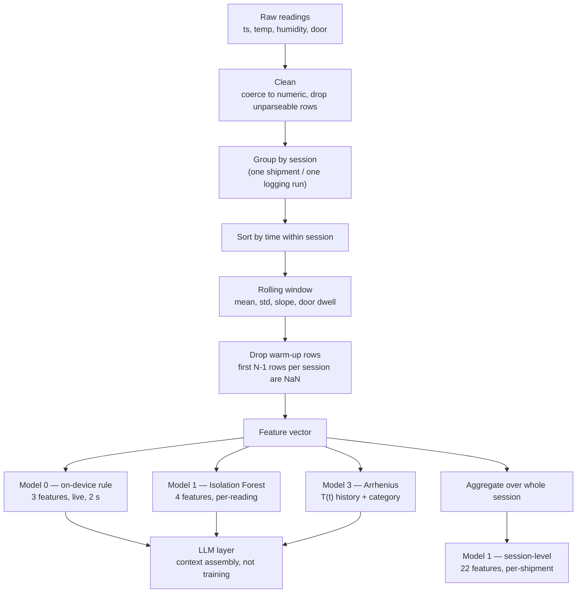
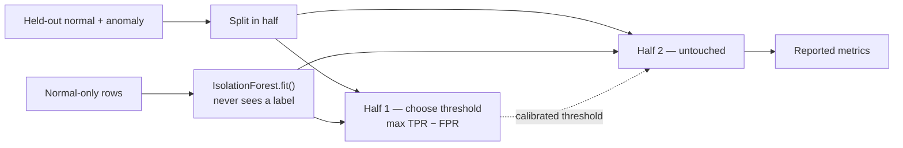

# FROSTMIND — Datasets & Feature Engineering

**What this document is.** A companion to *FROSTMIND — AI Models, Simple Overview* (the one-page model summary already submitted). That page answered *what each model is*. This one answers the two questions asked in response to it: **what data goes in, and how the raw sensor stream becomes the numbers a model actually sees.**

**How to read the tense.** Three of the five components run today, so their feature engineering is described in the present tense and every number below was measured from the actual data files and training scripts in this repository. Two components (Model 2, and Model 1 retrained on our own hardware logs) are not built yet — for those, this document specifies the dataset we will collect and the features we will engineer, at the same level of detail, so the design is reviewable now rather than after the fact. Each section is marked **BUILT** or **PLANNED** so the two are never confused.

---

## 1. Dataset inventory

Six data sources. Five exist on disk today; one — the most important one, our own hardware logs — is the thing the whole instrumentation build exists to produce.

| # | Dataset | Real or simulated | Size | Sampling cadence | Ground-truth label | Class balance | Used for |
|---|---|---|---|---|---|---|---|
| D1 | **NAB machine-temperature** (Numenta Anomaly Benchmark) | **Real** — a genuine machine failure, the field's standard benchmark | 22,695 readings, 2013-12-02 → 2014-02-19 | 5 min | 4 hand-labelled anomaly windows, incl. the catastrophic-failure window | ~11% of eval rows inside a window | Model 1 external checkpoint |
| D2 | **Kaggle "Data Sets Cold Chain Milk"** | **Real** — actual refrigerated milk transport logs | 92 session files, 58,273 usable readings | 5 min | Per-row `ACEPTABLE` / `ALERTA`, assigned by the original collector | 28.6% `ALERTA` | Model 1 external checkpoint |
| D3 | **Kaggle cold-chain shipment silent-failure** | **Simulated** — the author states 8,000 *synthetic* shipments | 8,000 rows × 24 columns | one row = one whole shipment (aggregated) | `silent_failure` ∈ {0,1} | 19.7% positive (1,574 / 8,000) | Model 1 checkpoint, both semi- and fully-supervised |
| D4 | **Kaggle IoT device temperature** | Real, but **unlabelled** | 97,606 readings, 2018-07-28 → 2018-12-08 | irregular | none | n/a | Exploratory profiling only — **no model trained on it** |
| D5 | **FROSTMIND hardware logs** | Real, once logged — **does not exist yet** | target ≈ 12,600 readings (§4) | 2 s | Session-level label applied by whoever ran the session | target ≈ 30% anomaly | Model 1, retrained for our own hardware |
| D6 | **AC power-draw logs (INA219)** | — | **no sensor, no data** | — | — | — | Model 2 — blocked on hardware, see §3.3 |

Two points worth stating out loud, because they are the ones a reviewer should press on:

- **We label D3 as simulated even though it is the dataset that scores best.** Its author describes it as 8,000 simulated shipments; an earlier project note had described it as having "real failure labels," and that was corrected after checking the source page directly. It is kept because its *target definition* — a failure that occurs with no alarm raised — is exactly FROSTMIND's problem, and because it is the only source with thousands of labelled outcomes. It is not presented as real-world evidence.
- **D4 trains nothing.** It has no anomaly labels, so it cannot produce a scored checkpoint. It was profiled (`models/iot_temp_profile.json`) and then deliberately left out of every model rather than padded into the results table.

### 1.1 Per-dataset notes that affected the feature code

**D1 — NAB.** A single continuous univariate series (`timestamp,value`), no door channel, no humidity. Values are a machine's internal temperature in the 2–108 range, mean ≈ 85.9 — not cold-chain temperatures at all. It is used as a *problem-shape* benchmark (detect a developing fault in a slow-moving temperature series), not as a cold-chain analogue. Our evaluation is point-based (a row is "anomaly" if its timestamp falls inside a labelled window); NAB's own leaderboard uses a different windowed score that rewards early detection, so our numbers are deliberately **not** presented as an NAB leaderboard result.

**D2 — Milk.** 92 separate Excel files, one per shipment, Spanish column headers (`Minutos`, `Temperatura`, `¿Valor Correcto?`). Sessions are wildly uneven — 14 readings at the shortest, 375 at the median, 2,945 at the longest — which is exactly why the split is done **by session, not by row** (§5). Temperatures span −0.5 °C to 8.0 °C, a genuinely narrow cold-chain band. **502 rows across the 92 files contain garbage where a number should be** (e.g. an `@` in the temperature column); the loader coerces to numeric and drops them rather than silently reading them as zero.

**D3 — Shipment.** Already feature-engineered by its author: one row is a completed multi-day shipment summarised into 22 predictors. Note a documented discrepancy — the Kaggle page's prose describes two target columns (`label` and `silent_failure`), but the downloaded CSV contains only `silent_failure`. Verified by reading the file header directly rather than trusting the page text.

---

## 2. The general pipeline — raw reading to feature vector

Every model in the system sits at a different point on the same pipeline. The single most important structural decision is marked in bold below: **windowed features are computed *within* one session and never across a session boundary.**



Why grouping comes before windowing: if you compute a 10-sample rolling mean over a table of concatenated sessions, the first nine rows of every session are a blend of that session and the *previous* session's tail. On D2 that would corrupt 4 rows × 92 sessions — a small leak in row count, but a completely fabricated signal at exactly the point (session start) where the model is most likely to be asked a real question.

---

## 3. Feature engineering, component by component

### 3.1 Model 0 — the on-device regulator · **BUILT, running live**

Three features, computed on the ESP32-S3 every 2 seconds from a **6-sample rolling buffer** (≈ 12 seconds of history).

| Feature | How it is computed | Units | Why this and not something simpler |
|---|---|---|---|
| `rate_of_change` | **Ordinary least-squares slope** fitted to the (t, temp) pairs currently in the 6-sample buffer, converted to °C/min | °C/min | A single `latest − previous` difference is dominated by sensor noise on a ±0.5 °C-accurate sensor. Fitting a line across six points rejects that noise and stays correct when samples arrive unevenly (BLE work can delay a loop tick) — the timestamps go into the fit, so an irregular interval does not distort the slope |
| `setpoint_deviation` | `temp − setpoint(category)`, where the setpoint comes from the product category stored in NVS | °C | Makes the same firmware correct for a −18 °C frozen load and a +5 °C vaccine load without a rebuild. This is the same normalisation idea §6 proposes lifting into Model 1 |
| `door_open_dur` | `now − doorOpenSinceMs`, from the reed switch (HIGH = open) | ms | A door genuinely open for a minute is a different event from a reed-switch bounce |

**The regression, precisely.** The slope is the closed-form OLS estimate

```
slope = ( n·Σ(t·T) − Σt·ΣT ) / ( n·Σt² − (Σt)² )   ×  60   →  °C/min
```

over the buffer, with `t` in seconds relative to the oldest sample. This is a *per-window fit on live data*, not a model trained offline on a dataset — there are no learned coefficients to store, which is exactly why it runs in a few hundred microseconds on the microcontroller with no model file at all.

**Decision thresholds (fixed, not learned):** |rate_of_change| > 3.0 °C/min, **or** |setpoint_deviation| > 3.0 °C, **or** door_open_dur > 60 s → alert. On alert, the paired IR command fires at the AC, with a **5-minute cooldown** so a sustained excursion cannot spam the unit.

**How we would validate this rule against the datasets — PLANNED.** The rule has no training set (nothing is learned), but it *can* be scored like a model, and that is the row worth adding to the summary sheet. The protocol: replay D1 / D2 / D3 through the identical rule — recompute the OLS slope over their series, use each dataset's own median normal temperature as its setpoint, apply the same three thresholds — and produce a confusion matrix against their real labels. That yields accuracy / precision / recall / ROC-AUC for the rule on the same four benchmarks Model 1 was scored on, which is the *right* comparison to make: it answers "does the learned model beat the 20-line rule?" — the first question anyone should ask of an anomaly detector. The two thresholds are the free parameters, so an ROC curve can be swept over them exactly as for Model 1. **Until that replay is run, the benchmark figures printed beneath Model 0 on the summary sheet are Model 1's numbers and should be read as such.**

### 3.2 Model 1 — anomaly detector · **BUILT, validated, not yet switched on**

Model 1 exists in two feature schemas because the data does. This distinction is the most-asked question about it, so it comes first:

| Schema | Granularity | Feature count | Which datasets | What it corresponds to in deployment |
|---|---|---|---|---|
| **Per-reading rolling window** | one row = one sensor reading | 3 (D1, D2) / 4 (D5) | NAB, milk, our own logs | Live streaming detection — the real target |
| **Session aggregate** | one row = one completed shipment | 22 | shipment silent-failure | Post-hoc "was this trip compromised?" scoring |

#### 3.2.1 Per-reading features

| Feature | Formula | Window | Available in |
|---|---|---|---|
| `roll_mean` | rolling mean of temperature | N samples | D1, D2, D5 |
| `roll_std` | rolling standard deviation of temperature | N samples | D1, D2, D5 |
| `rate_of_change` | first difference, `temp[i] − temp[i−1]` | 1 sample | D1, D2, D5 |
| `door_open_dur` | rolling **sum** of the binary door flag = samples in the window with the door open | N samples | **D5 only** — NAB and the milk dataset have no door channel |

`roll_std` is the feature doing the most conceptual work: a refrigeration failure shows up as *loss of control* — the temperature stops sitting tightly around a setpoint and starts wandering — often before the mean has moved far enough to trip a threshold. Mean, spread and slope together describe "where it is, how steady it is, where it is going," which is the minimum honest description of a controlled process.

**Window sizes, and a real inconsistency in them.** The window is specified in *samples*, and the datasets have very different cadences, so the same number means very different amounts of real time:

| Dataset | Window (samples) | Cadence | **Actual time span** |
|---|---|---|---|
| D1 NAB | 10 | 5 min | **50 minutes** |
| D2 Milk | 5 | 5 min | **25 minutes** |
| D5 FROSTMIND | 10 | 2 s | **20 seconds** |

A 20-second window and a 50-minute window are not the same feature wearing different clothes — they detect different physics. §6 fixes this by defining windows in time units and deriving the sample count from the measured cadence.

**Warm-up handling.** The first N−1 rows of every session have no complete window and come out `NaN`; they are dropped, per session, after grouping.

#### 3.2.2 Session-aggregate features (D3, 22 predictors)

Grouped by what they describe:

| Family | Features |
|---|---|
| Duration / handling | `transit_days`, `door_opens`, `leg_count` |
| Thermal | `temp_mean_c`, `temp_max_c`, `temp_min_c`, `temp_std_c`, `temp_recovery_rate` |
| Humidity | `rh_mean`, `rh_std`, `rh_max` |
| Load / packaging | `package_type`, `product_volume_l`, `fill_ratio` |
| Logistics identity | `carrier_id`, `origin_zone`, `dest_zone` |
| Sensor integrity | `sensor_gap_hours`, `vibration_index` |
| Latent (author-provided) | `feature_x1`, `feature_x2`, `feature_x3` |

`temp_recovery_rate` — how fast the box returns to setpoint after an excursion — is the one we would most want to reproduce on our own hardware, because it measures *cooling capacity* rather than temperature, and a compressor losing capacity degrades recovery long before it loses the setpoint entirely.

**Categorical handling — a known weakness.** `carrier_id`, `origin_zone`, `dest_zone` and `package_type` arrive as integer codes and are fed to the tree models as integers. Trees can split on them, so it is not fatal, but the encoding implies a false ordering (carrier 7 is not "more" than carrier 3). If this schema were carried into production we would one-hot encode the low-cardinality columns and target-encode `carrier_id` with out-of-fold means. It was left as-is here because these are synthetic identities in a simulated dataset with no real-world meaning to preserve.

**Scaling.** None, deliberately: Isolation Forest and Random Forest are both invariant to monotone rescaling of individual features. If we swap in a One-Class SVM or an autoencoder (both natural next steps), a `StandardScaler` becomes mandatory — and it must be **fitted on the training split only**, or the test set's distribution leaks into training through the scaler's own parameters.

#### 3.2.3 What the features are worth — measured

From the supervised Random Forest on D3 (Gini importance, actual output):

| Feature | Importance |
|---|---|
| `temp_max_c` | 0.163 |
| `transit_days` | 0.152 |
| `door_opens` | 0.132 |
| `rh_std` | 0.130 |
| `temp_std_c` | 0.085 |
| `temp_mean_c` | 0.055 |
| `rh_mean` | 0.045 |
| `temp_recovery_rate` | 0.042 |

The top four are peak excursion, exposure duration, handling count and humidity instability — all physically sensible — and notably **`temp_mean_c` ranks sixth**. Averages hide excursions; a shipment can average perfectly and still be ruined by two hours at 15 °C. That single result is the strongest argument in this document for why FROSTMIND logs at 2-second resolution instead of storing a per-trip average.

### 3.3 Model 2 — root-cause classifier · **PLANNED, blocked on hardware**

Not built, and deliberately not faked. What follows is the full design, so that "we did not build it" is a sourcing decision with a specification behind it rather than a gap.

**Why temperature alone cannot do this job.** A failed compressor and a door propped open produce nearly identical temperature curves — a steady rise toward ambient. The signal that separates them is **electrical**: a healthy compressor cycling against an open door draws current in its normal pattern; a failed compressor draws nothing, or draws a stalled-rotor current and trips. That is why the missing item is a sensor, not a script.

**The sensor:** an INA219 current/voltage monitor on the AC's supply, sampled at ~10 Hz.

**Features we would engineer from it:**

| Feature | Definition | The cause it separates |
|---|---|---|
| `current_rms_1min` | RMS current over a 1-minute window | Power cut (≈ 0 A) vs. everything else |
| `compressor_duty_cycle` | fraction of the last 10 min above the running-current threshold | Overworked unit (duty → 1.0) vs. normal cycling |
| `cycle_count_10min`, `mean_cycle_period` | compressor starts, and their spacing | Short-cycling — a classic early fault signature |
| `inrush_peak_ratio` | start-up current peak ÷ steady running current | A compressor struggling to start under mechanical load |
| `current_variance` | variance within the running phase | Mechanical roughness / failing bearing |
| `temp_response_after_command` | Δ temperature in the 5 min after an IR cool command | **Fusion feature:** current is drawn but temperature does not fall ⇒ refrigerant loss, not a control problem |
| `door_open_dur` | reused from Model 0 | The door-open cause, directly |
| `rate_of_change`, `roll_std` | reused from Model 1 | The thermal context the electrical features are interpreted against |

**Labels, and how we would obtain them — this is the cheap part.** Four classes: `normal`, `door_open`, `compressor_fault`, `power_loss`. Every one is *inducible on demand* on a test unit, which means labels come free with the collection protocol instead of needing an annotator: unplug the unit (`power_loss`), prop the door (`door_open`), block the condenser airflow to simulate loss of cooling capacity (`compressor_fault`), leave it alone (`normal`). Target: **20+ sessions per class, 15–30 minutes each**, each session labelled as a whole.

**Model and metric.** A Random Forest or gradient-boosted classifier — the feature count is small, the data volume will be modest, and the *explanation* matters as much as the prediction, so a model with readable feature attributions beats a neural one here. Scored with **macro-F1 and a full 4×4 confusion matrix**, not accuracy: the classes will not be balanced, and confusing `compressor_fault` with `door_open` is the specific error that would make the whole feature useless, so it has to be visible in the metric rather than averaged away.

### 3.4 Model 3 — shelf-life estimator · **BUILT, running live**

The inputs here are physical rather than statistical, so "feature engineering" means the transformation from a temperature stream into a degradation dose.

| Input | Source | Role |
|---|---|---|
| `T(t)` | every ingested reading for the shipment | the exposure history |
| `t` | reading timestamps, in hours | the integration variable |
| product category | set on the device / shipment | selects `Ea`, `A`, `T_ref`, rated shelf life |

**The transformation:**

```
k(T)     = A · exp( −Ea / (R·T) )                              Arrhenius rate constant, T in Kelvin
consumed = ∫ k(T(t)) dt  ÷  ( k(T_ref) · rated_shelf_life )    trapezoidal integration
```

The integral is the important modelling idea: it converts a temperature *curve* into a scalar **dose**, so six hours at 12 °C and thirty minutes at 30 °C become directly comparable quantities on one scale. A threshold rule cannot express that, which is precisely the gap Model 3 fills.

**Where the linear regression sits inside the Arrhenius model.** Taking logs of the Arrhenius equation gives

```
ln k  =  ln A  −  (Ea / R) · (1 / T)
```

which is a **straight line in `1/T`**, with slope `−Ea/R` and intercept `ln A`. That is how the two constants are obtained in practice: measure a product's degradation rate at several controlled temperatures, regress `ln k` on `1/T`, and read `Ea` off the slope. Our six categories currently use **illustrative literature-typical constants** (Q10 ≈ 2–3 ranges from food-science and pharma cold-chain sources), not values we regressed ourselves — stated in the code and repeated here, because certifying a specific payload would require running that regression against real lab data for that exact formulation.

| Category | `T_ref` | Rated shelf life at `T_ref` | `Ea` |
|---|---|---|---|
| Generic refrigerated vaccine | 5 °C | ~6 months | 83 kJ/mol |
| Pasteurized milk | 4 °C | ~2 weeks | 65 kJ/mol |
| Fresh produce | 3 °C | ~10 days | 55 kJ/mol |
| Chilled raw meat / poultry | 2 °C | ~5 days | 60 kJ/mol |
| Frozen food | −18 °C | ~6 months | 45 kJ/mol |
| Fresh chilled seafood | 0 °C | ~2 days | 70 kJ/mol |

**The learned correction layer — PLANNED.** The physics gives a prediction; reality gives an outcome. Once shipments carry recorded outcomes, we would fit a correction model on the **residual** (observed spoilage minus predicted consumption), using engineered features the plain integral throws away: excursion count, area-over-threshold (degree-hours above `T_ref`), longest single excursion, time-to-recovery after each excursion, and mean humidity. A small regression on top of a physical prior is the right shape when data is scarce — the physics carries the model until the data can improve it. It needs outcome-labelled shipments, which do not exist yet.

### 3.5 LLM layer — **BUILT, running live**

No training and no fine-tuning, therefore no training dataset. The engineering here is **context assembly** — deciding what the model is told:

| Put into the prompt | Deliberately kept out |
|---|---|
| The alert (type, threshold crossed, timestamp) | Raw reading history beyond the recent window (token budget) |
| Shelf-life % consumed and hours remaining, **precomputed** | Any request for it to do arithmetic itself |
| Recent readings window, product category, setpoint | Any control authority — it cannot fire an IR command |

The rule that matters: **numbers are computed by the deterministic models and passed in as ground truth the LLM is instructed never to recompute.** Its job is translation into a plain-English explanation and a recommended action, not calculation. Output is constrained to a JSON schema so the dashboard can render it — which is also why a quantization-aware-trained model was chosen, since QAT holds structured output together better than generic post-training quantization at the same size.

---

## 4. The dataset we still have to build (D5) — collection protocol · **PLANNED**

This is the gap that keeps Model 1 switched off, so the plan for closing it is specified concretely.

**Schema** (already fixed in code, in both the firmware's CSV logger and the database exporter):

```
ts, temp, humidity, door, rate_of_change, session_label
```

**Volume arithmetic.** At the 2-second loop cadence: 30 readings/min = **1,800 readings/hour**.

| Session type | How it is induced | Count | Duration each | Readings |
|---|---|---|---|---|
| `normal` baseline | Nothing — leave the unit running undisturbed | 1 | 4 h | ~7,200 |
| `door_open` | Hold the door open | 3 | 20 min | ~1,800 |
| `heat_source` | Hairdryer directed near the sensor | 3 | 20 min | ~1,800 |
| `power_loss` | Unplug the AC mid-session | 3 | 20 min | ~1,800 |
| | | | **Total** | **≈ 12,600 readings, ≈ 30% anomaly** |

**Labelling rules.** The label is applied at the **session** level by the person who physically ran it — a human judgment, and the tooling deliberately does not guess it. Two rules keep the labels honest:

1. **The recovery tail belongs to the anomaly session.** After the door closes, temperature takes minutes to return to setpoint. Those readings are still abnormal and stay inside the labelled clip; cutting the label at the moment of the physical action would teach the model that recovery is normal.
2. **One session = one shipment record**, started and ended in the app. That makes the session boundary a real database boundary rather than a spreadsheet convention — which is what makes the group-then-window rule of §2 mechanically enforceable rather than a thing we have to remember.

**Tooling that already exists for this.** `scripts/export_frostmind_log.py` pulls real ingested readings out of the database into exactly this CSV schema, with `--label` and `--append` so multiple sessions combine into one training file; `scripts/train_model1_frostmind.py` implements the 4-feature recipe against it and currently exits with these instructions instead of running; `backend/app/ml.py` checks at import whether a trained model for our own schema exists and begins scoring live readings the moment one does. The whole path is wired end-to-end — the only missing input is the physical logging sessions.

**One code fix required before the first run:** `train_model1_frostmind.py` imports a helper (`evaluate_semi_supervised`) that was superseded by the two-split `calibrate_and_evaluate` used everywhere else. It needs to be moved onto the calibration-split evaluation before that script is run, or its metrics will not be comparable to the four benchmark rows.

---

## 5. Methodology: splitting, leakage and metric choice

Feature engineering is only as trustworthy as the evaluation around it, so these are stated explicitly.

**Split strategy, chosen per dataset for a reason:**

| Dataset | Split | Why not a plain random row split |
|---|---|---|
| D1 NAB | **Chronological** — train on the normal lead-in before the first anomaly window (≈ 2,100 rows), evaluate from there onward | It is one continuous time series; a random split would train on rows from after the failure and test on rows from before it, which is time-travel |
| D2 Milk | **By session** — 64 sessions train, 28 held out | Rows within one shipment are heavily autocorrelated; a random row split would put minute 40 in training and minute 41 in test and score near-perfectly for no reason |
| D3 Shipment | **Stratified by row** (each row is already one whole independent shipment) | Rows are genuinely independent here, so stratifying on the rare class is the only requirement |
| D5 FROSTMIND | **By session**, per D2's reasoning | Same autocorrelation problem, worse — at 2 s cadence consecutive readings are nearly identical |

**Training regime.** Isolation Forest is fitted on **normal rows only**, `contamination=0.02`, `n_estimators=200` — the model itself never sees a label. That mirrors the real deployment condition: plenty of ordinary operating data, almost no confirmed failures.

**The two-split calibration, which is what makes the accuracy figures meaningful.** An anomaly score needs a threshold, and picking that threshold on the same rows you then report accuracy on is a leak. So the held-out data is split in half: half one picks the operating point (the point on the ROC curve maximising TPR − FPR, i.e. Youden's J), half two is untouched until final metrics are computed on it.



**Why accuracy is never reported alone.** These datasets are 11–30% anomalies, so a model that answers "normal" to everything already scores 70–89% accuracy. Balanced accuracy, ROC-AUC, average precision, precision, recall and F1 are all reported alongside it for exactly that reason.

**Two results we flag against ourselves rather than waiting to be asked:**

- The milk model's **100% recall** is real but easy: that dataset's `ALERTA` label appears to have been assigned by a simple temperature threshold in the first place, so any model that can see rolling temperature statistics can recover it. It is a sanity check that the pipeline works, not evidence of a hard problem solved.
- The supervised shipment result (82.3% accuracy, 0.913 ROC-AUC) is the **ceiling available when thousands of labels exist**, not a forecast of day-one performance on our own hardware. The semi-supervised rows (74–86%) are the honest analogue of the real deployment condition.

---

## 6. Known weaknesses in the current feature set, and the v2 we would build

The most important finding from building this is that **the current per-reading feature set cannot be shipped across product categories as-is** — and the reason is a feature-engineering reason, not a modelling one.

**The problem.** `roll_mean` is a raw Celsius value. An Isolation Forest trained on milk-transport data learns that "normal" means roughly −0.5 to 8 °C. Point it at a frozen load at −18 °C and it flags *every single reading* as anomalous — not because anything is wrong, but because the feature carries an absolute scale the model has no way to interpret per category. A detector that is confidently wrong is worse than one that is honestly switched off, which is why the trained models are not wired to live telemetry today.

**The fix is a feature change, not a model change** — v2 of the schema:

| v1 feature | v2 replacement | What it buys |
|---|---|---|
| `roll_mean` (°C, absolute) | `roll_mean_dev` = rolling mean − `setpoint(category)` | One model valid for all six categories; −18 °C frozen and +5 °C vaccine both read "zero deviation" when healthy |
| `rate_of_change` (per sample) | `rate_of_change_per_min` (per minute) | Comparable across the 2 s / 5 min cadence gap between our hardware and the benchmark datasets |
| `door_open_dur` (sample count) | `door_open_seconds` | Same reason — a sample count silently encodes the cadence |
| window = N samples | window = **T minutes**, sample count derived from measured cadence | Removes the 20-second-vs-50-minute inconsistency of §3.2.1 |
| — | `dwell_above_setpoint` — fraction of the window spent above setpoint | Distinguishes a brief spike from a sustained excursion at the same mean |
| — | `recovery_slope` — slope over the window following a door-close event | Measures cooling *capacity*, the D3 feature-importance result we most want to reproduce |
| — | `time_since_last_ir_command` | Tells the model a cooling command was just issued, so a post-command transient is not read as a fault |
| `roll_std` | unchanged | Already scale-relative, and already the most informative of the three |

**Why one normalised model rather than six per-category models.** Six models means splitting already-scarce data six ways, and a category with no logged sessions gets no detector at all. A single model over category-normalised features shares statistical strength across all of them and generalises to a seventh category the day one is added. If per-category data ever becomes plentiful, the normalised model remains the right baseline for a per-category model to beat.

---

## 7. Anticipated questions

**"Why is there no deep learning here?"** The labelled data available for this domain is 8,000 synthetic shipments and 92 real milk sessions — nowhere near the volume that would let a neural model beat a tree ensemble, and tree ensembles give the per-feature attributions we need in order to explain an alert to a human. If D5 collection scales to hundreds of sessions, a 1-D CNN or an LSTM autoencoder over the raw window becomes worth testing against this baseline, and the two-split evaluation harness already in place is what it would be tested with.

**"Is the 2-second cadence overkill?"** The D3 feature-importance result argues it is not: `temp_max_c` outranked `temp_mean_c` by roughly 3×. Peak excursions carry the signal, and peaks are exactly what a coarse cadence averages away.

**"You have 58,000 real milk readings — why is that not enough to deploy?"** Because they are 58,000 readings of *someone else's* refrigeration, in a single narrow temperature band, with no door sensor and no humidity channel. They validate that the method works; they cannot calibrate what normal looks like on our hardware for our six product categories. That is the specific gap D5 closes.

**"What would change your mind about the feature set?"** Running the §3.1 replay. If the 20-line threshold rule scores within a point or two of the Isolation Forest across all four benchmarks, Model 1's added complexity is not earning its place, and the honest conclusion would be to ship the rule and spend the effort on Model 2's electrical features instead.

---

*Every measured figure in this document was read from the data files and training-script output in this repository on 2026-09-09. Sections marked PLANNED describe work not yet performed.*
