# FROSTMIND — Model 4 (Mixed-Load Setpoint) and Model 5 (Co-Shipment Compatibility)

**Project:** FROSTMIND cold-chain AIoT monitoring system · **Document:** technical submission for the two models requested by the professor · **Date:** 27 September 2026

[[TOC]]

## 1. Executive summary

The professor asked for two models:

1. **Model 4, ideal temperature for a mix of different products.** A reefer truck has only one setpoint. When it carries several products, what should that setpoint be?
2. **Model 5, which products can be shipped together.** Given any two products, can they share a compartment? Given a whole order, how should it be split into compartments?

Both are **built, trained, evaluated, and live** in FROSTMIND:
- the backend endpoint `POST /planner/plan`;
- a new **Load Planner** page in the admin web panel;
- 64 passing backend tests.

The table below gives the headline numbers. Every number was measured on **products the model never saw during training**.

| | What it is | Trained on | Headline result (unseen products) | Best simple rule, for comparison |
|---|---|---|---|---|
| **Model 5** | Random-forest classifier over 13 physical pair features | 5,671 produce pairs labelled by **USDA expert compatibility groups** (McGregor 1989, Agricultural Handbook 668) | **ROC-AUC 0.930 ± 0.034, accuracy 86.7%, F1 0.822, MCC 0.717** (mean ± std over 30 product-disjoint splits) | "optimal temps within 2 °C": AUC 0.839, MCC 0.663 |
| **Model 4** | Gradient-boosting regressor (the "student") distilled from a physics-informed robust optimizer (the "teacher") | 16,000 simulated mixed loads of **real catalog products**, with **real reefer temperature fluctuation** from the Kaggle cold-chain milk logs | **MAE 0.16 °C, R² 0.999, 93.6% within ±0.5 °C** of the optimum | "midpoint of the shared range": MAE 1.32 °C, 48.1% within ±0.5 °C |

To build these we collected and cleaned new data: **155 products** from 4 public sources plus cited regulations. Every cleaning step is logged with row counts (Section 3).

> **Honesty notes, stated up front** (details in Section 9):
> - Model 5's labels are real expert labels, but only for produce. Dairy, meat and pharma pairs are handled by cited regulations plus a physics check, not by the ML.
> - Model 4's training loads are simulated and labelled by our own physics model. The ML student learns to reproduce that physics quickly and safely. It is externally checked against USDA's published group temperatures, and it agrees for the cold groups but not for some warm ones. We report that honestly.

## 2. The problem and why it matters for FROSTMIND

Before this work, FROSTMIND assumed **one product category per shipment**. It had six categories (vaccines, milk, produce, meat, frozen food, seafood), each with one reference temperature (`scripts/model3_shelf_life.py`). Real trucks carry mixed loads, which raises two practical questions:

- **Some products must not travel together.**
  - **Ethylene:** apples and bananas emit ethylene gas, which ripens, yellows or spoils ethylene-sensitive items such as lettuce and kiwifruit.
  - **Temperature:** tropical fruit gets chilling injury at the 0 °C that lettuce needs.
  - **Regulation:** medicines must be segregated from food (WHO / EU Good Distribution Practice), and raw meat must be kept apart from ready-to-eat food (FDA Food Code 3-302.11).
- **Products that can travel together still need one shared setpoint.** Too cold and chilling-sensitive items are injured or freeze. Too warm and everything spoils faster; spoilage roughly doubles to triples for every 10 °C (Q10). The best temperature depends on the mix, on how much of each product there is, and on how much the truck's temperature wobbles.

FROSTMIND already measures the truck's temperature (ESP32 + DHT22), tracks shelf-life consumption (Model 3, Arrhenius), and can set the air-conditioner setpoint per category over BLE. Models 4 and 5 add the missing planning step: **decide what goes in which compartment, and at what temperature, before the truck leaves.**

## 3. Data: collection and cleaning

### 3.1 Why new data was needed

None of FROSTMIND's existing datasets (NAB machine temperature, Kaggle milk, Kaggle shipment, IoT room temperature) contain any product storage properties or compatibility information. So we built a product catalog from public, citable sources.

- `scripts/fetch_product_data.py` downloads each source page and saves it unchanged as a raw snapshot in `data/product_catalog/raw/`.
- Each snapshot's URL, HTTP status, size and **SHA-256 hash** are recorded in `raw/SOURCES.json`.
- The cleaning script only ever reads these snapshots, so the pipeline is **reproducible** even if a website changes.

### 3.2 Sources

| # | Source | Rows | What we took from it |
|---|---|---|---|
| S1 | **Engineering ToolBox**, *Fruits and Vegetables – Optimal Storage Conditions* (engineeringtoolbox.com/fruits-vegetables-storage-conditions-d_710.html) | 125 | Storage temperature range (°F), chill point, freezing point, humidity, **ethylene production** and **ethylene sensitivity**, storage life |
| S2 | **USDA Agriculture Handbook 66** (Hardenburg, Watada & Wang), as reproduced in UMaine Extension Bulletin 4135 (extension.umaine.edu/publications/4135e/) | 85 storage + 18 chilling rows | Independent cross-check of S1, gap filling, and HB66's **"lowest safe temperature"** chilling-injury table |
| S3 | **McGregor, B.M. 1989, *Tropical Products Transport Handbook*, USDA Agricultural Handbook 668**, as reproduced by FAO (fao.org/4/ae075e/ae075e16.htm) | 7 groups, 159 listed members | The expert **mixed-load compatibility groups**, plus explicit "not with …" exceptions. These are **Model 5's labels** and Model 4's external check. They are **never** used as features. |
| S4 | **Virginia Tech Extension pub. 348-960**, *Food Storage Guidelines for Consumers* (pubs.ext.vt.edu/348/348-960/348-960.html) | 29 rows used | Refrigerated and frozen storage times for dairy, eggs, meat, poultry, seafood and frozen foods |
| S5 | `raw/non_produce_manual.csv`, 35 rows, **each with its citation** | 35 | Temperature bands from **FDA Food Code 2022** (≤ 5 °C cold holding for TCS foods; ≤ 7 °C shell eggs), the **CDC Vaccine Storage & Handling Toolkit** (2–8 °C; −50 to −15 °C; −90 to −60 °C) and **USP ⟨659⟩** (controlled room temperature). These agencies' websites refuse scripted downloads (HTTP 403), and each value is a single regulatory number, so they were entered by hand with the source on every row. |
| S6 | **Kaggle cold-chain milk** (already in the project, `data/kaggle_cold_chain_milk/`) | 92 real sessions | The real **temperature fluctuation σ** of a refrigerated transport (Section 3.6) |

### 3.3 Cleaning pipeline

`scripts/build_product_catalog.py` performs the steps below. Each step's counts are written to `data/product_catalog/cleaning_report.json`.

| Step | What was wrong in the raw data | What we did | Rows affected |
|---|---|---|---|
| 1. Extract | HTML table with a stray header row (`%`) | Stdlib `html.parser` table extractor; kept rows with all 11 columns | 127 → 125 |
| 2. Synonyms and typos | `Beans. Lima` (full stop for comma), `Green Beans` vs `Beans, green or snap`, `Green Peas` vs `Peas, green`, `Onions` meaning *dry* onions | Synonym map to one canonical name | 4 |
| 3. Typo in a Yes/No column | `Ne` instead of `No` (Kiwi, unripe) | Corrected | 1 |
| 4. Parse and convert units | Temperatures as °F text ranges (`30 - 40`, `55–70`, `32`), humidity as `90-95`, ethylene as words, storage life as `1-12 months` | Parsed ranges to (min, max), converted °F to °C, mapped ethylene words to ordinals (0–4 production, 0–2 sensitivity), converted storage life to days using the **geometric** midpoint (ranges span an order of magnitude) | 125 (62 missing freezing points, 33 missing ethylene, 50 missing storage life) |
| 5. Duplicates | The same product listed twice with different, partly conflicting cells (Cauliflower, Escarole, Peas, Quinces, Tangerines, …) | Merged: the row that **agrees with USDA HB66** wins; otherwise the most complete row. Gaps are filled from the other row, and every conflict is logged. | 125 → 119, 15 conflicts |
| 6. Cross-check with HB66 | — | Matched 82 products to HB66: **midpoint temperature MAE 0.26 °C** (90% identical), freezing points identical. The two big disagreements, potatoes (8.6 vs 3.9 °C) and watermelon (16.9 vs 12.8 °C), are listed in the report. | 82 matched, 14 gaps filled |
| 7. HB66-only rows | Green onions missing from S1 | Added | +1 |
| 8. Chilling sensitivity | S1 "chill point" is sparse | Threshold taken from HB66's lowest-safe-temperature table (preferred) or the S1 chill point. **Chilling-sensitive** if the threshold ≥ 2 °C or t_min ≥ 7 °C. | 18 from HB66; 38 products flagged |
| 9. Sibling imputation | e.g. `Carrots, mature` has no ethylene data but `Carrots, bunched` does | Filled from rows of the same commodity; source recorded in `imputed_fields` | 14 ethylene, 10 freezing point, 4 storage life |
| 10. Category imputation | Remaining gaps | Fruit/vegetable median (mode for ethylene classes); flagged in `imputed_fields` | 15 ethylene, 39 freezing point, 33 storage life |
| 11. McGregor labels | McGregor's names differ from S1's (`berries (except cranberries)`, `leafy greens`, `sweetpotatoes`) | Hand-written mapping, printed in full in the report. Group **sets** are kept, because 26 crops appear in more than one group. | 107 produce products labelled; 56 exotic McGregor crops have no catalog entry |
| 12. Non-produce rows | — | S5 temperature bands plus S4 storage times (text such as `3-5 days` or `1-2 months` converted to days) | 35 rows; 29 shelf lives from VT |
| 13. Validation | — | Checks that t_min ≤ t_opt ≤ t_max, the freezing point is below the storage range, RH is within 0–100, shelf life is plausible, and ids are unique | **155 rows, 0 problems** |

**Leakage rule.** No feature is ever filled from the McGregor groups, because those groups are the label. A unit test enforces this: it shuffles the labels and checks that every feature stays identical (`backend/tests/test_products.py`).

### 3.4 The cleaned catalog

`data/product_catalog/product_catalog_clean.csv` has **155 products**: 46 fruits, 74 vegetables, 8 dairy, 1 eggs, 6 meat, 2 poultry, 6 seafood, 6 frozen and 6 pharmaceutical. It has 24 columns, including:
- temperature range and optimum, humidity range, freezing point;
- chilling sensitivity and threshold, shelf life, Q10;
- ethylene production and sensitivity;
- safety class and regulatory hard limits;
- the McGregor label set, source URL, and an `imputed_fields` audit column (105 rows have at least one imputed value, and each says where it came from).

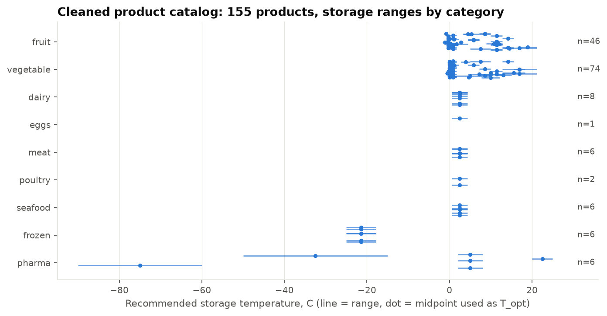

### 3.5 Keeping Model 3 and Model 4 consistent (Q10)

Model 4 needs to know how fast each product spoils as temperature rises. FROSTMIND's Model 3 already defines an Arrhenius activation energy *Ea* for each of its six categories. We convert that to a Q10 so the two models agree:

`Q10 = exp( 10 · Ea / (R · T1 · T2) )`, where T1 = T_ref and T2 = T_ref + 10 K.

For example, milk (Ea = 65 kJ/mol at 4 °C) gives Q10 = 2.67. All produce uses the `fresh_produce_generic` value (Q10 = 2.31). Section 7.6 shows the setpoint is insensitive to ±20% changes in this number.

### 3.6 Real temperature fluctuation (σ)

A reefer never holds its setpoint exactly. `scripts/estimate_reefer_fluctuation.py` measures σ on the **real** Kaggle milk-transport sessions:
- **Normal operation** (in-spec readings of 72 sessions): median σ = 0.31 °C (p90 0.65 °C).
- **Sessions with excursions** (63 sessions): median σ = 0.56 °C (p90 1.12 °C).

The sensors report in 0.5 °C steps, so σ is floored at 0.2 °C. FROSTMIND's own database (5,932 readings) holds bench tests at about 29 °C, not reefer data, so it only supplies the sensor noise floor (0.11 °C).

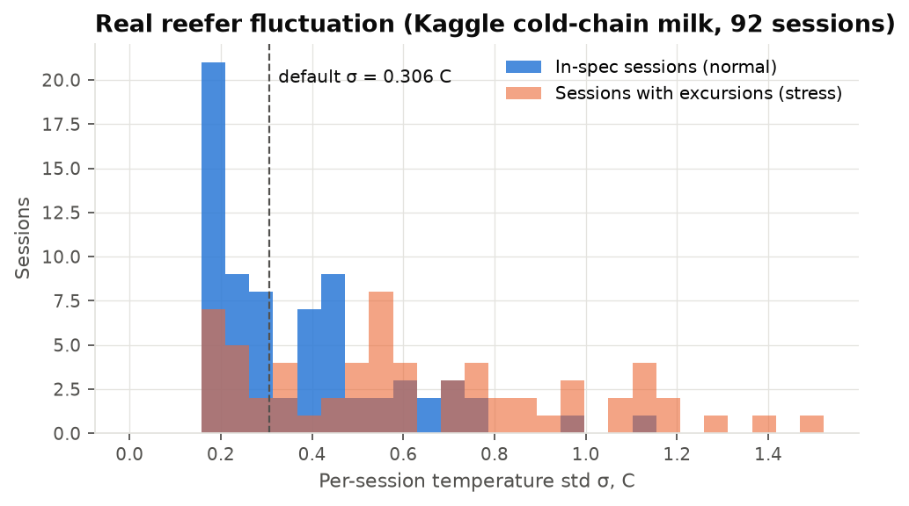

## 4. Shared design: one code path for training and serving

All features, physics and grouping live in **`scripts/common/products.py`**. The training scripts import it, and the live backend imports the same file (`backend/app/load_planner.py`, the same way `app/ml.py` already imports Model 3). What the models were trained on is therefore exactly what they are scored on in production, with no train/serve skew.

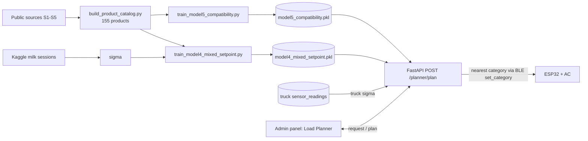

## 5. Model 5: co-shipment compatibility

### 5.1 Labels (ground truth)

McGregor (USDA AH-668) sorts about 85 crops into 7 groups, each with a temperature, a humidity, and an ethylene role. Examples:
- **G1**, 0–2 °C / 90–95% RH: many ethylene producers (apples, pears, grapes, berries, …);
- **G2**, 0–2 °C / 95–100% RH: ethylene-sensitive leafy vegetables;
- **G6**, 13–15 °C: tropical fruit.

For two catalog products that McGregor grouped, the pair is **compatible (1)** if their group sets overlap. McGregor's explicit exceptions ("figs not with apples", "green onions not with figs, grapes, mushrooms, rhubarb or corn", "sweet potatoes and watermelon separate from pears and tomatoes") override this to **incompatible (0)**.

This gives 107 products and **5,671 labelled pairs, 40.4% compatible**. We deliberately did **not** invent labels for dairy, meat or pharma pairs using our own rules. A model trained on rule-generated labels would just learn the rules back, and its accuracy would be meaningless.

### 5.2 Features

There are 13 **symmetric** features per pair, computed by `pair_feature_frame()`. A symmetry test checks that (A, B) and (B, A) give identical values.

| Feature | Meaning |
|---|---|
| `temp_overlap_c` | Width of the overlap of the two recommended temperature ranges (negative means a gap) |
| `topt_diff_c`, `topt_mean_c` | Difference and mean of the two optimal temperatures |
| `rh_overlap`, `rh_mid_diff` | Humidity-range overlap and difference of the humidity midpoints |
| `ethylene_risk` | max(production_A × sensitivity_B, production_B × sensitivity_A) |
| `ethylene_prod_max`, `ethylene_sens_max` | Strongest producer and most sensitive product in the pair |
| `chill_risk_c` | How far one product's optimum sits below the other's chilling limit |
| `freeze_risk_c` | How far one product's low end sits below the other's freezing point |
| `n_chilling_sensitive` | 0, 1 or 2 |
| `log_shelf_life_ratio` | Mismatch in storage life |
| `same_category` | Both fruit, or both vegetable |

### 5.3 How it was trained and evaluated

Every product appears in about 100 pairs. A random split of *pairs* would let the model see each test product during training and simply remember it. We avoid that with a **product-disjoint** protocol:

1. Split the **products** 70/30, stratified by McGregor group.
2. **Train** on pairs where both products are in the training set (2,701 pairs).
3. **Test** on pairs where both products are in the test set (528 pairs). This is a strict cold start: the model has never seen either product.
4. Choose the decision threshold with **Youden's J** on out-of-fold predictions from a 5-fold *product-level* cross-validation inside the training products. The test set is never touched.
5. Repeat the whole procedure for **30 random product splits** and report the mean ± standard deviation.

Three algorithms were compared, all with `class_weight="balanced"` (the hyperparameters are stored in the metrics file):
- **logistic regression**, with standardisation and median imputation;
- **random forest**: 300 trees, min_samples_leaf 3;
- **histogram gradient boosting**: learning rate 0.05, 300 iterations, max depth 4.

They were benchmarked against two rules an expert might write by hand. The winner, **random forest** (chosen by mean MCC), was refit on all 5,671 pairs. Its final threshold, from product-level cross-validation, is **0.463**.

### 5.4 Results

| Model (unseen products, 30 splits) | ROC-AUC | PR-AUC | Accuracy | Balanced acc. | Precision | Recall | F1 | MCC |
|---|---|---|---|---|---|---|---|---|
| **Random forest (selected)** | **0.930 ± 0.034** | **0.917** | **0.867** | **0.855** | **0.843** | 0.805 | **0.822** | **0.717 ± 0.063** |
| Gradient boosting | 0.928 ± 0.034 | 0.907 | 0.862 | 0.851 | 0.838 | 0.803 | 0.817 | 0.709 ± 0.065 |
| Logistic regression | 0.915 ± 0.032 | 0.890 | 0.836 | 0.828 | 0.792 | 0.795 | 0.787 | 0.660 ± 0.070 |
| Rule: optimal temps within 2 °C | 0.839 | 0.694 | 0.830 | 0.839 | 0.737 | 0.876 | 0.798 | 0.663 ± 0.068 |
| Rule: ranges overlap and no ethylene clash | 0.808 | 0.690 | 0.825 | 0.808 | 0.796 | 0.736 | 0.763 | 0.627 ± 0.083 |

- When **one** product of a pair is unseen, the random forest reaches ROC-AUC 0.963, accuracy 90.5% and MCC 0.803.
- Pooled over all 30 splits, its confusion matrix is: 8,734 true "separate", 4,994 true "compatible", 926 false "compatible", 1,186 false "separate".

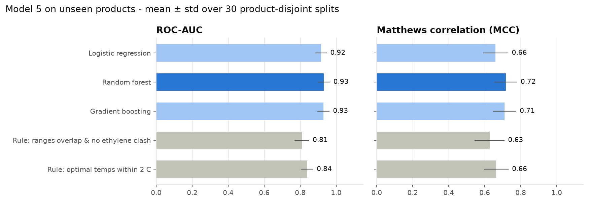

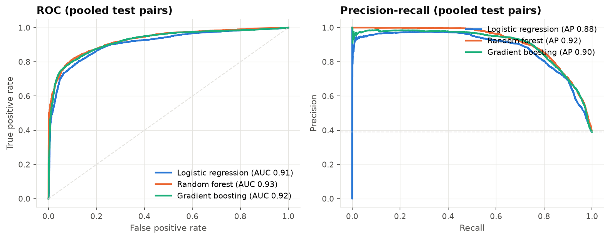

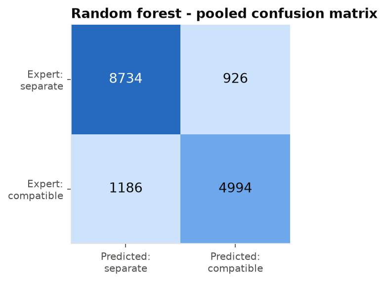

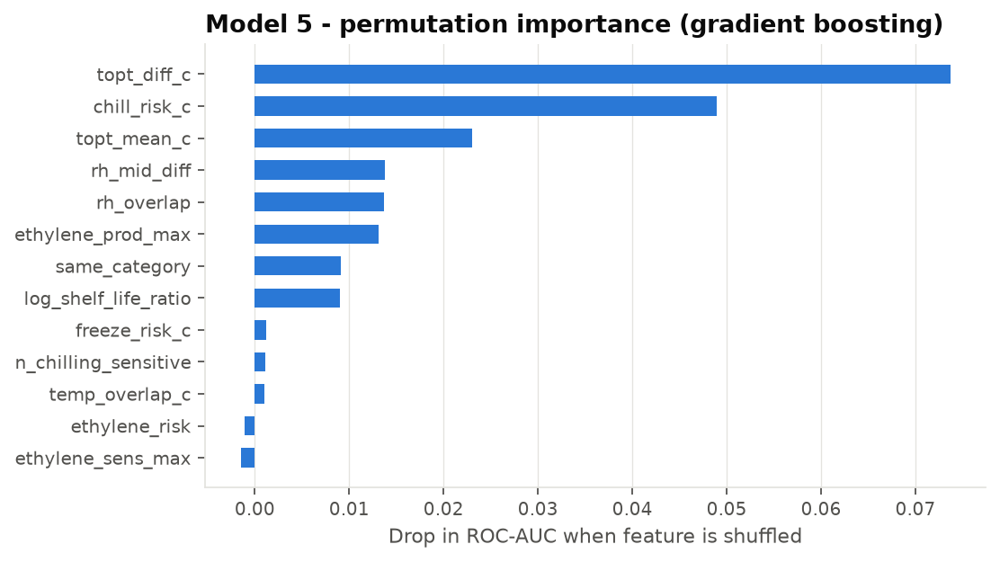

### 5.5 What the model learned, and where it errs

- **Optimal-temperature difference and chilling risk dominate.** That matches how McGregor built the groups, which are mainly temperature classes.
- **Ethylene adds little on its own.** McGregor's two big 0–2 °C groups (producers in G1, sensitive leafy vegetables in G2) share many crops, such as berries, grapes, cherries and radishes, so ethylene is not a clean separator in the labels. The planner still *explains* ethylene clashes to the user (Section 8), and the raw physics check still applies.
- **ML beats the best rule by about 9 AUC points and 0.05 MCC.** The rule "optimal temps within 2 °C" has high recall but lower precision, because it pairs products that sit near each other in temperature but differ in humidity or chilling behaviour.
- **What it's for:** the model's real use is products McGregor never grouped. For example, it pairs basil with sweet peppers, cucumbers and eggplant (the 7–10 °C crops), and southern peas with lima beans. These predictions are stored in `models/model5_compatibility_metrics.json`.

### 5.6 From pairs to compartments (grouping)

1. The backend builds an *incompatibility graph*: an edge joins any pair that is vetoed, infeasible, or below the threshold.
2. It colours the graph with the **DSatur** algorithm (Brélaz 1979). Each colour is a set of mutually compatible products, which becomes one compartment or truck.
3. If a group turns out to have no common legal setpoint once σ margins stack up, its most distant pair is split and the graph is recoloured.

## 6. Policy layer: rules that ML must never override

Two regulatory rules are applied **on top of** Model 5 as hard vetoes, and every response says which one fired:

- **Medicines never share a compartment with food.** Source: WHO TRS 961 Annex 9 and EU GDP Guidelines 2013/C 343/01.
- **Raw animal foods are kept apart from produce and ready-to-eat food.** Source: FDA Food Code 3-302.11.

Frozen and chilled products are separated automatically, because no single setpoint is feasible for both (Model 4's feasibility check). These rules were **never** used as training labels (Section 5.1).

## 7. Model 4: ideal temperature for a mixed load

### 7.1 The physics teacher

For product *i* at actual temperature X, the expected loss per day, as a fraction of its shelf life, is:

`ℓᵢ(X) = Q10ᵢ^((X − T_opt,i)/10) / SLᵢ  +  κᵢ · (Lᵢ − X)₊²  +  κ_f · (T_f,i − δ − X)₊`

The three terms are:
- **Spoilage:** Arrhenius/Q10 decay relative to the rated shelf life SL.
- **Lower wall at t_min:** chilling injury. Its stiffness κ is 0.05 for chilling-sensitive products and 0.01 otherwise.
- **Freezing damage:** κ_f = 1 per °C below the freezing point minus a 0.5 °C supercooling allowance δ.

Pharmaceuticals use a symmetric band penalty instead, `κ_p[(t_min − X)₊² + (X − t_max)₊²]`. That puts 2–8 °C vaccines at exactly 5.0 °C, as the CDC toolkit recommends.

**Robustness to the truck's wobble.** The actual temperature is X = μ + ε with ε ~ N(0, σ²). All three expectations have **closed forms** (a lognormal factor for the Q10 term, normal partial moments for the walls), so the optimum is computed exactly, not by Monte Carlo. The load objective weights each product by its mass share:

`J(μ) = Σᵢ wᵢ · E[ℓᵢ(μ + ε)]`

**Legal limits** are **chance constraints**: the setpoint must stay 2σ inside every hard limit, so about 97.7% of readings stay legal on each side. The limits are:
- pharma band;
- FDA ≤ 5 °C for dairy, meat and seafood; ≤ 7 °C for shell eggs;
- ≤ −17.8 °C for frozen food;
- above the freezing point for fresh products.

The teacher minimises J on a 0.05 °C grid inside that safe interval. It returns:
- the setpoint;
- a near-optimal band (within 10% of the minimum);
- each product's expected loss per day.

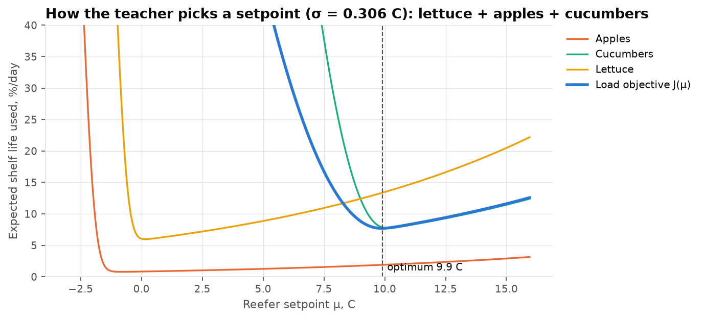

### 7.2 Why also train an ML model?

The teacher is exact, but it needs every product's full kinetic parameters. The ML student maps a compact 24-number summary of the load straight to the setpoint. It is:
- **compact and fast:** a single 1.3 MB tree ensemble, a candidate to run on the phone bridge or at the edge;
- **the component that learns from reality later:** once FROSTMIND logs delivery-quality outcomes, the student is fine-tuned on them. This is the same "learned correction layer" already planned for Model 3.

In production the two work together as **guarded ML**. The student's answer is clipped into the safe interval and served only if it agrees with the teacher to within 0.5 °C. Otherwise the teacher's answer is served, and the response says so.

### 7.3 Training data (simulated loads, real ingredients)

- **Loads:** 20,000 feasible mixed loads, each 1–8 products, with quantity shares drawn from a Dirichlet distribution.
- **σ:** drawn from the *real* milk σ distribution (75% normal sessions, 25% excursion sessions).
- **Sampling mix:** 40% from the same McGregor group, 30% from the same temperature regime (optima within 3 °C), 30% random.
- **Excluded:** loads violating the policy rules.
- **Labels:** the teacher's optimum for each load.
- **Split:** the **products** were split 108/47 first. The 16,000 training loads use only training products, and the 4,000 test loads use only test products.
- Stored in `data/product_catalog/mixed_load_scenarios_{train,test}.csv.gz`.

### 7.4 Features and the extrapolation fix

The student uses 25 permutation-invariant load features (`LOAD_FEATURE_COLS`). One of them, the weighted-mean optimum, serves as the anchor described below, which leaves 24 model inputs. They include:
- the safe interval;
- the warmest t_min and coldest t_max;
- the weighted mean and spread of the optima;
- the highest chilling wall and freezing point;
- the fractions of chilling-sensitive, pharma and frozen products;
- the mean Q10 and shelf life;
- σ.

The first version predicted absolute temperatures and failed badly on ultra-cold mRNA vaccines (−75 °C) and room-temperature medicines (22.5 °C). Both happened to fall only in the test split, and tree models **cannot extrapolate** beyond the targets they were trained on. The fix is to make the student **shift-invariant**:
- every temperature feature is expressed relative to the load's weighted-mean optimum;
- the target becomes "setpoint minus that anchor".

This cut test MAE from 0.41 °C to 0.16 °C and the number of large errors (> 3 °C) from 82 to 2. A unit test checks the invariance.

### 7.5 Results on unseen products

| Model (4,000 test loads, unseen products) | MAE (°C) | RMSE (°C) | R² | Within ±0.5 °C | Within ±1 °C | Mean regret (%/day) |
|---|---|---|---|---|---|---|
| **Gradient boosting (selected student)** | **0.159** | **0.316** | **0.999** | **93.6%** | **97.9%** | 0.283 |
| Random forest | 0.162 | 0.336 | 0.999 | 93.5% | 97.9% | 0.108 |
| Baseline: midpoint of shared range | 1.323 | 2.321 | 0.955 | 48.1% | 65.4% | 7.157 |
| Baseline: weighted mean of optima | 1.415 | 2.433 | 0.950 | 44.5% | 62.9% | 5.298 |
| Baseline: warmest product's optimum | 1.359 | 1.865 | 0.971 | 31.6% | 50.8% | 0.727 |

*Regret* is the extra shelf life lost per day by using the prediction instead of the true optimum. The student cuts the error of every rule by about **8×**. The random forest has slightly lower mean regret; gradient boosting was chosen by MAE, as decided before the run. Either is a defensible choice.

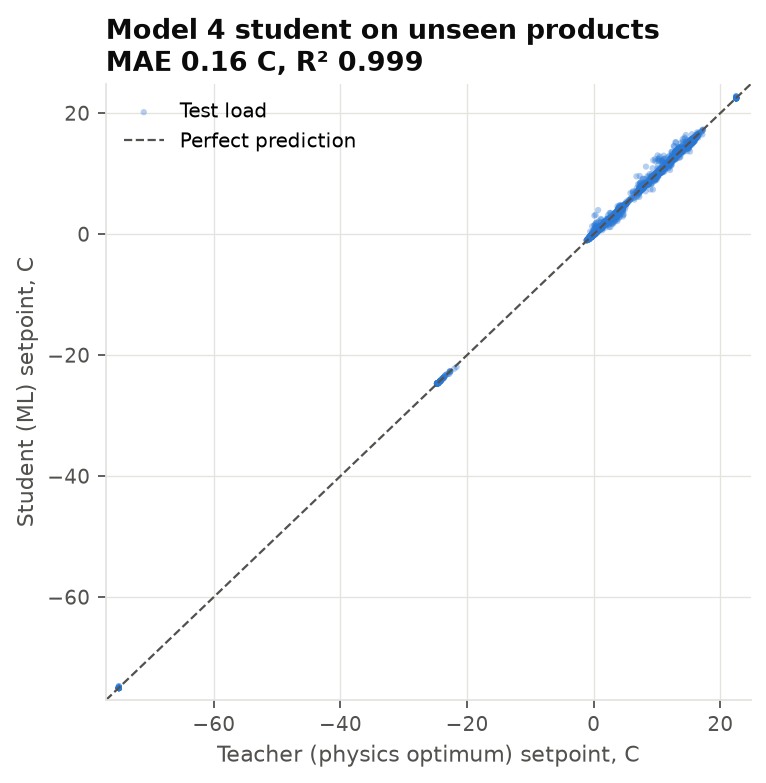

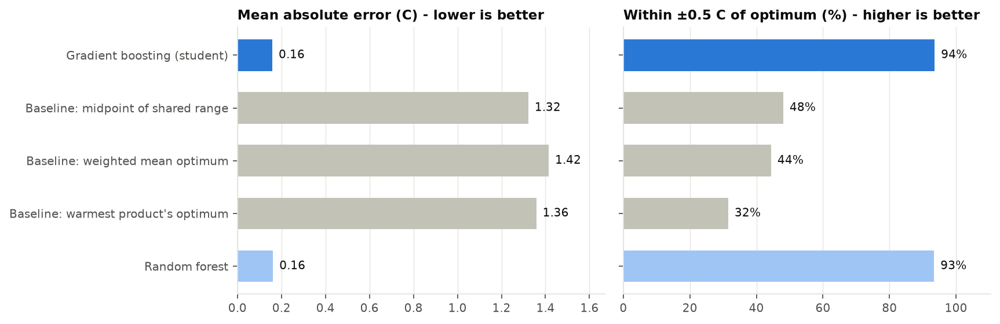

### 7.6 External validation and sensitivity

**Against McGregor's published group temperatures**, which were never used in Model 4, we took each group plus 100 random 2–5-member subsets at the default σ:

| McGregor group (published temp.) | Teacher inside range | Within ±0.5 °C | Median setpoint | Members whose *own* HB66/S1 range even overlaps the group's |
|---|---|---|---|---|
| G1 (0–2 °C) | 6.9% | 42.6% | −0.2 °C | 82% |
| G2 (0–2 °C) | 35.6% | **91.1%** | −0.05 °C | 97% |
| G3 (0–2 °C) | 100% | **100%** | 0.35 °C | 100% |
| G4 (4.5 °C) | 32.7% | 33.7% | 10.9 °C | 83% (lemons: 11–13 °C in S1) |
| G5 (10 °C) | 44.6% | 44.6% | 7.6 °C | 75% (snap and lima beans: 3–7 °C) |
| G6 (13–15 °C) | 16.8% | 46.5% | 13.2 °C | 65% |
| G7 (18–21 °C) | 0% | 0% | 13.1 °C | 75% (sweet potato: 13–16 °C) |

How to read the table:
- **Cold groups agree.** For G1–G3 the teacher agrees within ±0.5 °C in most cases. It tends to sit just below 0 °C because HB66 recommends −1 to 0 °C for pears, grapes and cherries.
- **Warm groups disagree, and the right-hand column explains why.** The per-product tables we used (HB66 via UMaine, Engineering ToolBox) themselves recommend different temperatures from McGregor's 1989 groups for several warm-group crops. The disagreement is between the **sources**, not a modelling error, and we report it rather than tune it away.
- The student matches the teacher closely on this check.

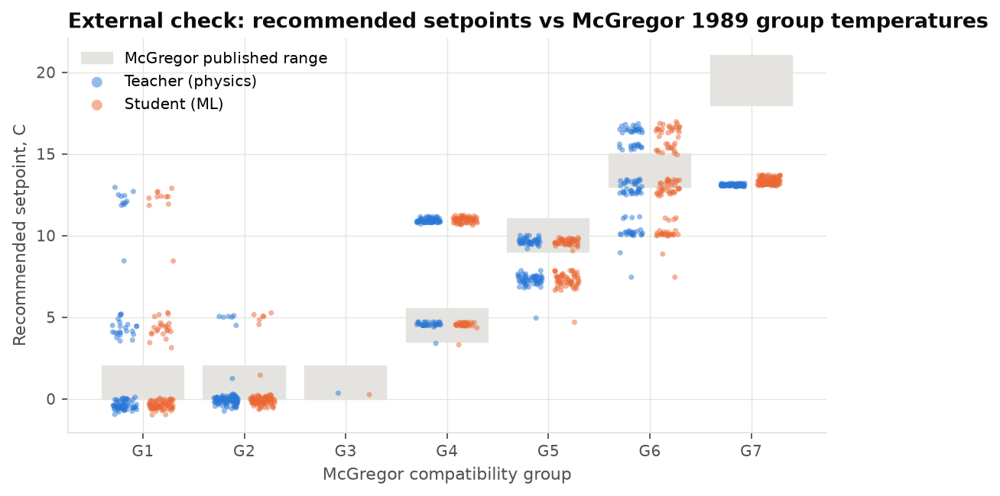

**Other checks:**
- **Single products:** the teacher's optimum lies within 0.5 °C of the product's own published range for **89.9%** of the 149 non-pharma products.
- **Sensitivity**, over 300 test loads (mean absolute shift of the optimum):
  - κ_f from 1.0 to 0.3 or 3.0: 0.03–0.04 °C;
  - κ_chill from 0.05 to 0.02 or 0.1: 0.09–0.15 °C;
  - produce Q10 ± 20%: 0.06–0.09 °C;
  - supercooling allowance 0 or 1 °C: 0.07–0.15 °C.

  So the recommendations are robust to the uncertain constants.

### 7.7 Worked examples (default σ = 0.31 °C)

| Load | Teacher | Student | Near-optimal band | Expected loss (%/day) |
|---|---|---|---|---|
| Apples + pears + grapes | −0.70 °C | −0.50 °C | −1.15 to 0.65 | 1.7 |
| Lettuce + broccoli + spinach | 0.05 °C | 0.04 °C | −0.05 to 1.30 | 7.7 |
| Bananas + mangos + avocados (ripe) | 13.25 °C | 13.07 °C | 12.55 to 14.55 | 6.9 |
| Cucumbers + sweet peppers + eggplant | 9.85 °C | 9.67 °C | 9.05 to 11.15 | 9.3 |
| Milk + yogurt + hard cheese | 0.40 °C | 0.39 °C | −0.25 to 1.60 | 4.9 |
| Raw chicken + raw beef | −0.75 °C | −0.76 °C | −0.85 to 0.85 | 37.8 (1–2 day shelf life) |
| Vaccines + insulin | 5.00 °C | 4.95 °C | 2.65 to 7.35 | 0.0 |
| Frozen vegetables + ice cream | −24.60 °C | −24.59 °C | −25.05 to −22.60 | 0.3 |

## 8. Where the models are used in FROSTMIND

### 8.1 Backend

`backend/app/load_planner.py` loads both `.pkl` files at startup. It follows the same graceful pattern as Model 1: if a file is missing, the planner falls back to physics and rules instead of crashing, and `/health` reports `model4_status` and `model5_status`.

- `GET /products` returns the 155-product catalog (public reference data, like `/categories`).
- `POST /planner/plan` (admin JWT) runs these steps:
  1. **Model 5** scores every pair (probability + policy vetoes + Model 4 feasibility), with plain-English reasons.
  2. **DSatur** splits the order into compatible compartments.
  3. **Model 4** recommends each compartment's setpoint, guarded by the physics teacher. It also names the nearest of the six FROSTMIND device categories, which the ESP32 already applies over BLE `set_category`, and warns when no category is within 1 °C (e.g. bananas at 13.5 °C must be set manually).
- **σ** comes from the request, or from the truck's own last 500 readings (at least 30 needed), or from the real-data default.

Example request:

```
POST /planner/plan
{"products": [{"product_id": "bananas_ripe", "quantity_kg": 200},
              {"product_id": "lettuce", "quantity_kg": 150},
              {"product_id": "apples", "quantity_kg": 300},
              {"product_id": "vaccines_refrigerated", "quantity_kg": 20}]}
```

Response, abridged from a live run:

```
sigma_c 0.306 (default, real milk-transport data)   model4_active true   model5_active true
Compartment 1  bananas_ripe           13.51 C  method=ml  (physics check 13.55 C)  -> set manually (no device category near)
Compartment 2  lettuce                 0.13 C  method=ml  (physics check 0.15 C)   -> seafood_fresh_chilled (0 C)
Compartment 3  apples                 -0.81 C  method=ml  (physics check -0.85 C)  -> seafood_fresh_chilled (0 C)
Compartment 4  vaccines_refrigerated   4.97 C  method=ml  (physics check 5.00 C)   -> vaccine_generic (5 C)
bananas + lettuce   p=0.00  keep apart  "Ethylene: Bananas, ripe produces ethylene (medium) and Lettuce is sensitive."
lettuce + apples    p=0.12  keep apart  "Ethylene: Apples produces ethylene (high) and Lettuce is sensitive."
apples + vaccines   veto    "Medicines must be segregated from food (WHO TRS 961 Annex 9; EU GDP 2013/C 343/01)."
```

### 8.2 Admin panel: the Load Planner page

The new page (`web/src/app/planner/page.tsx`, linked as **Load Planner** in the nav bar) lets a dispatcher:
1. pick products (or a preset);
2. enter kilograms;
3. optionally choose the truck, so its own measured wobble is used.

It then shows:
- one card per compartment: setpoint, near-optimal band, safe range, ML vs physics value, device category, and each product's shelf-life use per day;
- a clickable compatibility matrix with Model 5 probabilities;
- the reason each pair was separated.

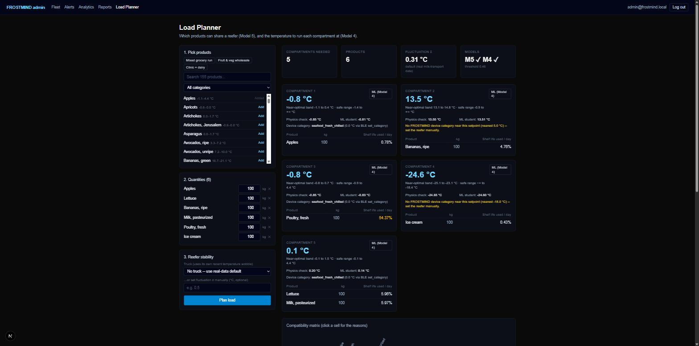

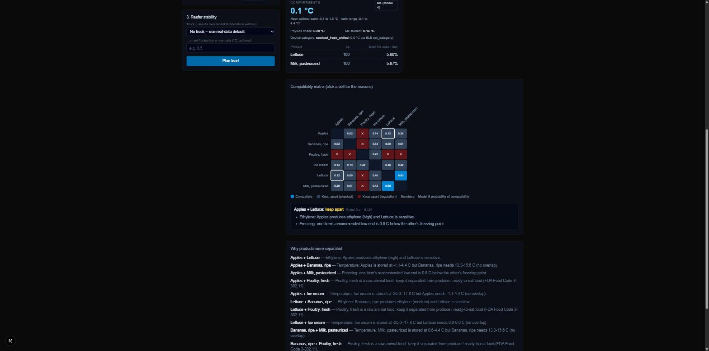

The full data flow is the architecture diagram in Section 4 (rendered as `docs/figures/model4_5/architecture.png`).

### 8.3 Tests

**64 backend tests pass**: the 34 that existed before plus 30 new ones.

`backend/tests/test_products.py` covers:
- the physics sanity targets: lettuce 0–2 °C; apples + pears about 0 °C; tropical fruit 12.5–14 °C; vaccines 5.0 °C at any σ; frozen + chilled infeasible;
- the FDA limit as a chance constraint;
- Q10 derived from Model 3;
- feature symmetry and the label-leakage guard;
- DSatur validity;
- the student's shift-invariance.

`backend/tests/test_planner.py` covers:
- authentication;
- the catalog;
- apples + pears grouped together; bananas + lettuce separated; vaccines vetoed from food; frozen separated from chilled;
- setpoints inside their safe range;
- the device-category warning;
- σ fallback;
- behaviour with no `.pkl` files.

The web app passes ESLint, TypeScript checking and `next build`.

## 9. Limitations and honest caveats

- **Model 4's labels come from our physics model**, not from measured delivery quality. The student reproduces the teacher; it cannot be better than the teacher's assumptions (κ values, Q10, the chance-constraint level). The sensitivity analysis shows the setpoints are robust to these, and the external McGregor check shows where published sources disagree.
- **Model 5's ML only covers produce**, because that is where expert labels exist. Pairs involving dairy, meat, seafood, frozen or pharma get a probability marked `extrapolated`, but the decision for them rests on the cited regulations and the physics feasibility check.
- **Source conflicts are real.** HB66 and McGregor disagree for several warm crops (potatoes, lemons, beans, sweet potato). We keep both and report the conflict instead of choosing silently.
- **Some values are imputed** (39 freezing points, 33 shelf lives, 15 ethylene classes). All are flagged in `imputed_fields`. The non-produce freezing points are category-level assumptions.
- **σ comes from milk transport**, not from FROSTMIND's own trucks. The planner switches to a truck's own σ once it has at least 30 readings.
- **The device supports only six category setpoints.** The planner warns when a recommendation cannot be applied by the ESP32; arbitrary setpoints would need a firmware change.
- **Not certified.** This is a university prototype. Pharmaceutical shipments must follow the product's labelled storage conditions.

## 10. How to reproduce

```
.venv\Scripts\python.exe scripts\fetch_product_data.py
.venv\Scripts\python.exe scripts\build_product_catalog.py
.venv\Scripts\python.exe scripts\estimate_reefer_fluctuation.py
.venv\Scripts\python.exe scripts\train_model5_compatibility.py
.venv\Scripts\python.exe scripts\train_model4_mixed_setpoint.py
cd backend ; ..\.venv\Scripts\python.exe -m pytest
..\.venv\Scripts\python.exe -m uvicorn app.main:app --port 8001
cd ..\web ; npm run dev      # then open http://localhost:3000/planner
```

`scripts/train_all.py` runs the whole pipeline together with the earlier models. All random seeds are fixed at 42, and a full rerun reproduced every number in this document.

**Files delivered:**
- **Data:** `data/product_catalog/` (raw snapshots, cleaned catalog, cleaning report, σ, training pairs and loads).
- **Code:**
  - `scripts/common/products.py`;
  - `scripts/fetch_product_data.py`;
  - `scripts/build_product_catalog.py`;
  - `scripts/estimate_reefer_fluctuation.py`;
  - `scripts/train_model5_compatibility.py`;
  - `scripts/train_model4_mixed_setpoint.py`;
  - `backend/app/load_planner.py`;
  - `backend/app/routers/planner.py`;
  - `web/src/app/planner/page.tsx`.
- **Models:** `models/model5_compatibility.pkl` and `models/model4_mixed_setpoint.pkl`, each with a `_metrics.json` file.
- **Figures:** `docs/figures/model4_5/`.

## 11. References

1. Hardenburg, R.E., Watada, A.E., Wang, C.Y. (1986). *The Commercial Storage of Fruits, Vegetables, and Florist and Nursery Stocks*. USDA-ARS Agriculture Handbook 66 (as reproduced in University of Maine Cooperative Extension Bulletin 4135).
2. McGregor, B.M. (1989). *Tropical Products Transport Handbook*. USDA Office of Transportation, Agricultural Handbook 668 (as reproduced in FAO, *Small-Scale Postharvest Handling Practices*, ch. 7).
3. The Engineering ToolBox (2004). *Fruits and Vegetables – Optimal Storage Conditions*.
4. Virginia Cooperative Extension (2019). *Food Storage Guidelines for Consumers*, pub. 348-960.
5. U.S. FDA (2022). *Food Code*, §3-501.16 (cold holding), §3-202.11 (shell eggs), §3-302.11 (separation of raw animal foods).
6. U.S. CDC. *Vaccine Storage and Handling Toolkit*.
7. United States Pharmacopeia. General Chapter ⟨659⟩ *Packaging and Storage Requirements*.
8. WHO Technical Report Series 961, Annex 9, *Model guidance for the storage and transport of time- and temperature-sensitive pharmaceutical products*; EU *Guidelines on Good Distribution Practice of medicinal products for human use* (2013/C 343/01).
9. Brélaz, D. (1979). New methods to color the vertices of a graph. *Communications of the ACM* 22(4).
10. Kaggle. *Data Sets Cold Chain Milk* (92 real transport sessions), already used by FROSTMIND Model 1.
